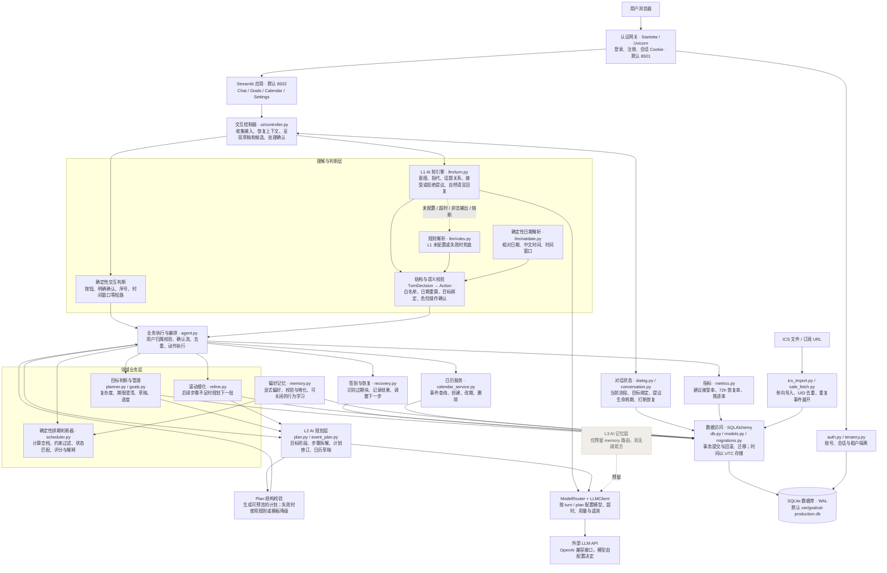
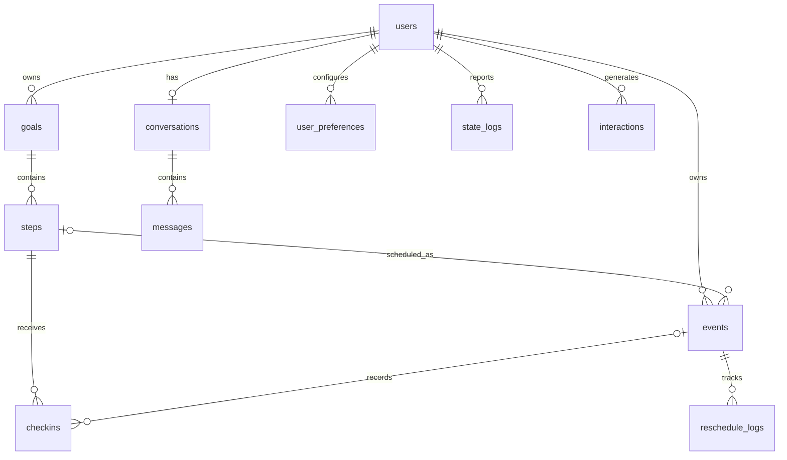
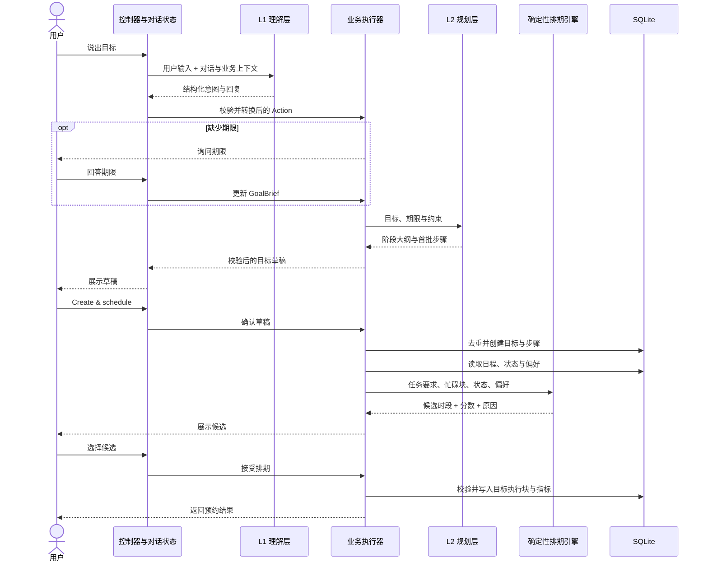

> 历史资料：保留当时记录，命令、路径、功能和待办不代表当前版本。当前资料见 [文档索引](../README.md)。

# GoalCal 系统架构图

基于 2026-11-03 工作区代码整理。当前是 Python + Streamlit 模块化单体，图中的分层代表代码职责，并非独立微服务。

## 1. 系统总览

AI 不直接读写数据库。控制器和业务层装配上下文，AI 输出结构化提议；校验、确认和数据库操作由应用代码负责。普通对话或路由轮次最多调用一次 L1，明确需要规划时可追加 L2；按钮及部分明确输入可直接走代码。

## 2. “判断器”分别判断什么

项目没有独立部署的通用 Judge 服务，也没有额外的大模型裁判；判断能力分布在以下模块。

| 判断环节 | 实现位置 | 作用 | 使用 AI |
|---|---|---|---|
| 对话关系与意图 | `llm/turn.py` | 判断新指令、流程内回答、接受或拒绝提议、澄清等，输出 `TurnDecision` | L1 |
| 明确交互与降级解析 | `ui/controller.py`、`llm/rules.py` | 确认、取消、序号选择和时间重筛；模型失败时解析可识别指令 | 否 |
| 执行前校验 | `llm/action.py`、`llm/turn.py`、`agent.py`、`ui/controller.py` | 校验字段、动作范围、所属用户及目标绑定；高风险动作进入确认流 | 否 |
| 目标复杂度与澄清 | `domain/planner.py` | 判断目标类型和复杂度；缺期限时先澄清，再生成计划 | 否 |
| 日期与时间窗口 | `llm/natdate.py`、`timeutil.py` | 重算相对日期和时段，处理本地时间与 UTC 边界 | 否 |
| 计划有效性 | `llm/plan.py` | 校验 AI 返回的阶段、步骤、时长等结构，清理或拒绝无效输出 | 否 |
| 候选时段判断与评分 | `domain/scheduler.py` | 根据忙碌日程、缓冲、每日上限、精力、任务类型和偏好筛选并排序 | 否 |
| 过期与恢复判断 | `domain/recovery.py`、`agent.py` | 判断过期执行块；根据累、没时间、卡住、不想做等原因生成恢复动作 | 主要为确定性代码；细化可按需调用 L2 |

排期引擎是纯函数：输入日程、任务要求、状态与偏好，输出带 `score` 和 `reasons` 的候选时段。推荐不是模型随意给出的时间；用户选定候选后，业务层才执行预约。明确指定钟点的指令可以走直接排期路径，并经过相应校验。

## 3. 数据库与核心关系

| 数据组 | 表 | 保存内容 |
|---|---|---|
| 用户 | `users` | 账号、密码哈希、时区和启用状态 |
| 目标与计划 | `goals`、`steps` | 期限、状态、置顶、阶段大纲、步骤时长、精力要求、完成进度 |
| 日历与执行 | `events`、`checkins`、`reschedule_logs` | 外部事件、目标执行块、签到结果、未完成原因、改期记录 |
| 状态与偏好 | `state_logs`、`user_preferences` | 精力状态、明确排期偏好、来源、证据与有效期 |
| 对话 | `conversations`、`messages` | 消息、草稿、候选、待确认动作、提议和打断恢复状态 |
| 产品指标 | `interactions` | 建议、接受、执行、恢复等行为埋点 |

上图覆盖 `models.py` 中的核心业务实体；认证辅助存储由 `auth.py` 管理。对话流程主要存放在 `conversations.state_json`，没有另建提议表。应用内切页保留对话；整页重进或新会话会重置本次消息和临时流程，目标与日历业务数据保留。当前记忆使用结构化偏好与历史事件，没有向量数据库；行为学习结果在排期偏好物化时计算，不自动写回偏好表。

## 4. 一次“创建目标并安排时间”的链路

## 5. 代码依据

- 入口与部署：[`app.py`](../../app.py)、[`service.py`](../../goalcal/service.py)、[`auth_proxy.py`](../../goalcal/auth_proxy.py)。
- 控制与执行：[`controller.py`](../../goalcal/ui/controller.py)、[`agent.py`](../../goalcal/agent.py)、[`dialog.py`](../../goalcal/dialog.py)。
- AI 分层：[`turn.py`](../../goalcal/llm/turn.py)、[`plan.py`](../../goalcal/llm/plan.py)、[`router.py`](../../goalcal/llm/router.py)。
- 领域判断：[`planner.py`](../../goalcal/domain/planner.py)、[`scheduler.py`](../../goalcal/domain/scheduler.py)、[`recovery.py`](../../goalcal/domain/recovery.py)。
- 数据与记忆：[`models.py`](../../goalcal/models.py)、[`db.py`](../../goalcal/db.py)、[`memory.py`](../../goalcal/memory.py)。
